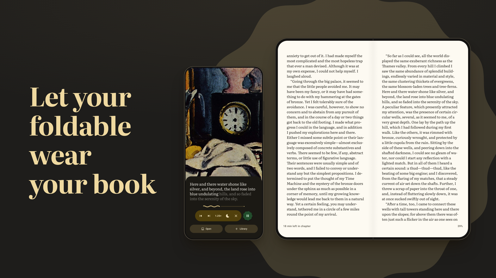
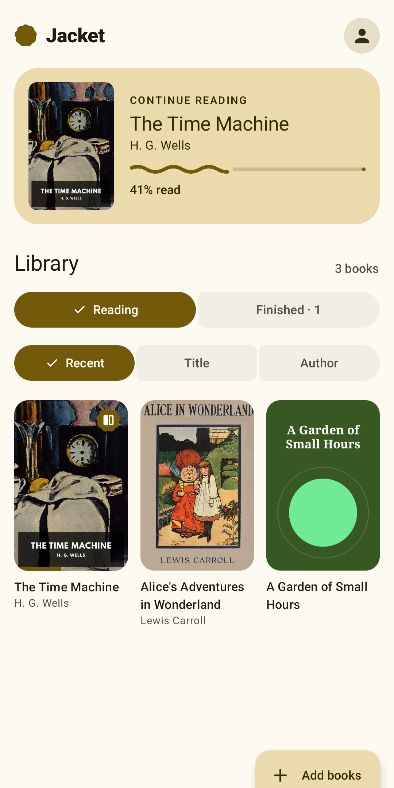
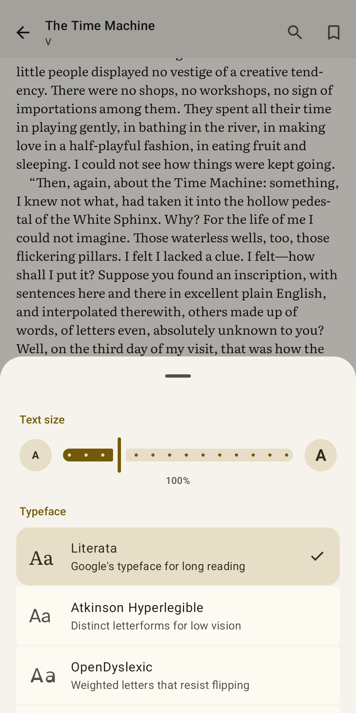
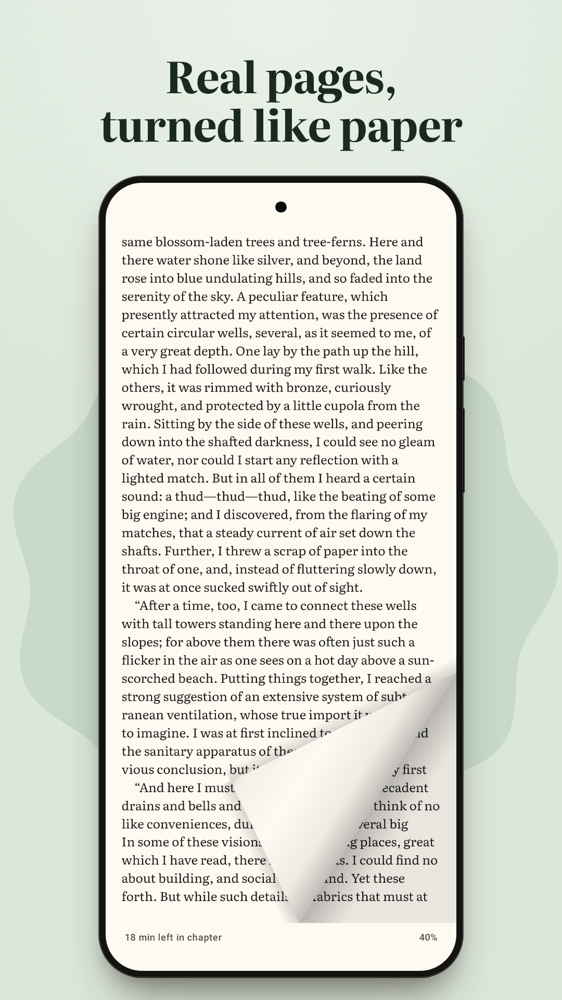
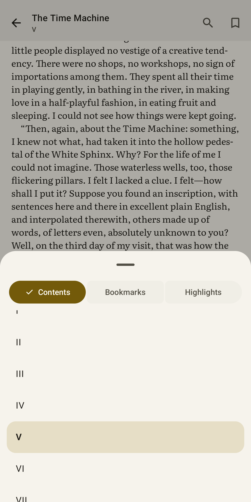
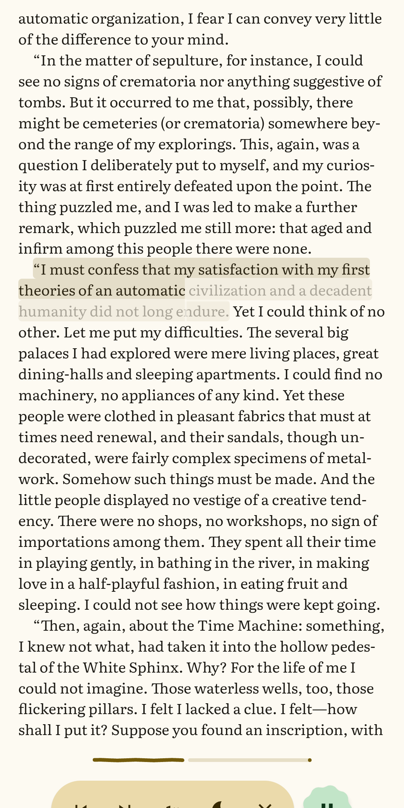
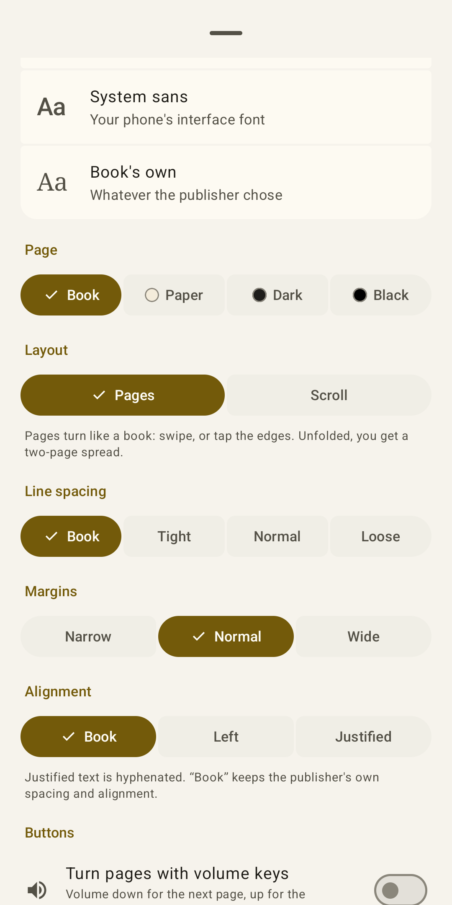
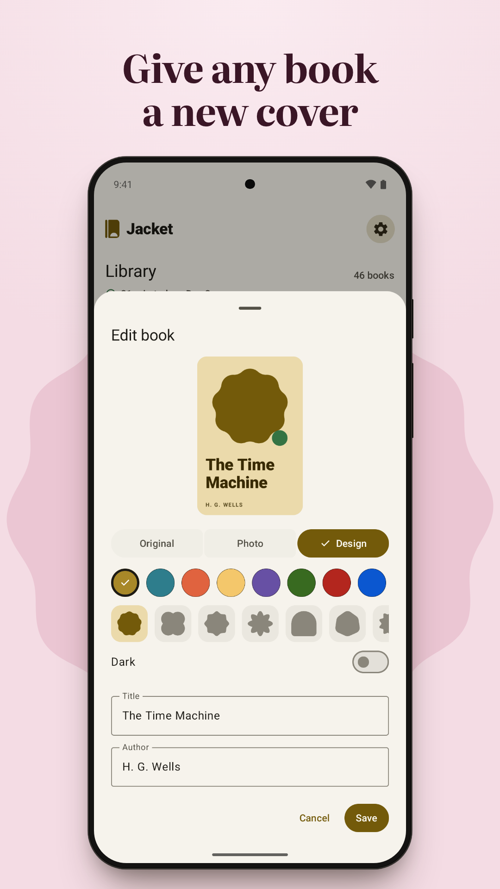
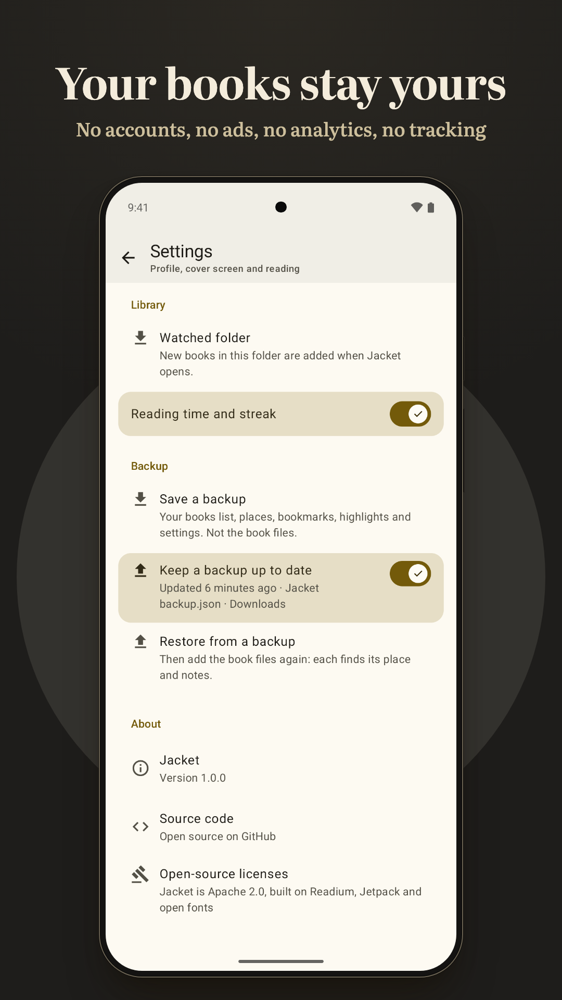

# Jacket

**Let your foldable wear your book.** Jacket is a free, open-source e-reader for Android. Pages
turn like paper, natural voices read any book aloud on the phone itself, and on a foldable the
outer screen shows the cover of the book you're reading, like album art.

<p align="center">
  
</p>

**[Download for Android](https://github.com/friendlyglobal/jacket/releases/latest)** ·
Google Play: coming soon ·
[Website](https://usefriendly.app/products/jacket/) ·
[Privacy policy](https://usefriendly.app/products/jacket/privacy/) ·
[Support](https://usefriendly.app/products/jacket/support/)

<p>
  
  
  
  
</p>
<p>
  
  
  
  
</p>

- **The cover, on the outside.** While you read inside a foldable, the outer screen shows the
  book's cover edge to edge and follows your reading. Fold it shut and the cover can stay on,
  with a player while it reads aloud. On a Galaxy Z Flip it's a cover-screen widget.
- **Real pages.** The page lifts under your finger and turns like paper. Unfold the phone for a
  two-page spread.
- **Or just listen.** Natural voices come with the app and speak 31 languages, with no internet.
  Each word lights up as it's read, and the page turns with the voice.
- **Your own books, and free ones.** EPUB, PDF, CBZ comics and plain text, plus 114 classics in
  16 languages to download for free.
- **Nothing leaves your phone.** Jacket has no internet permission: no accounts, no ads, no
  analytics, no tracking.
- **In 18 languages**, with a Brazilian voice for Brazilian readers.

## Install

- **From GitHub:** open the [latest release](https://github.com/friendlyglobal/jacket/releases/latest),
  download `Jacket-1.1.0.apk` and open it. Your browser asks once to be allowed to install apps.
  It's about 200 MB, because the voices are inside, and it runs on Android 8 and later. Later
  versions install over it the same way, keeping your books and places.
- **Google Play:** coming soon.

> **Coming from a test build?** Test builds were signed for testing, so this release can't
> install over them. In the test build, save a backup (Settings › Backup), then uninstall it,
> install the release, restore the backup and add your book files again: each one finds its
> place and notes.

Reports from Pixel Fold, Galaxy Z Fold/Flip and Razr owners are very welcome in
[issues](https://github.com/friendlyglobal/jacket/issues).

## Everything it does

### Reading
- **Your own files:** EPUB, PDF, CBZ comics and plain text. Use **Add books**, or *Open with* /
  *Share* from any app (shared text becomes a book too). Jacket keeps a private copy and pulls out
  the title, author and cover, generating a typographic cover when a file has none.
- **Real pages for EPUB**, rendered by [Readium](https://readium.org), the open-source toolkit
  behind many reading apps: proper pagination, publisher styles, images and links. Pages turn
  like paper: the page lifts off under your finger and slides over the next with a soft shadow,
  then settles with a spring. Or pick another turn: *Curl* folds the page over like a leaf of a
  book, *Cards* deals it away on a spring, *Slide* keeps Readium's plain strip of pages. At the
  first and last page the sheet gives a little and springs back. Swipe or tap the outer edges to
  turn; tap anywhere else for the controls. Unfolded (or in
  landscape), you get a two-page spread. Or switch to continuous scrolling, where taps only
  bring up the controls.
- **Contents and progress:** the book's own table of contents, sub-chapters included, with the
  chapter you're in tracked as you read (even when a whole book is one file), "pages left in
  chapter" (or, once Jacket has seen your pace in the book, the minutes left), and a smooth
  scrubber that previews the chapter under your thumb. After a jump through the contents, a
  search or the scrubber, a "Back" pill returns you to the page you left.
- **Comforts, each with its own switch:** swipe up or down the page's left edge for brightness
  and its right edge for warmth; light pages that turn dark with the phone's dark theme; and a
  tabletop mode that, half-folded on a table, puts the page above the fold and page-turn buttons
  (or the read-aloud player) below it.
- **Typography:** Literata (Google's typeface for long reading), Atkinson Hyperlegible and
  OpenDyslexic, alongside the system serif and sans and the book's own fonts. Text size, line
  spacing, margins, justified text with hyphenation, and Book, Paper, Dark or Black pages.
  Settings apply live and keep your place.
- **Keys, page-turners and a mouse:** arrow keys, Page Up/Down and Space turn pages (the arrows
  follow a right-to-left book), a Bluetooth page-turner works without touching the screen, and a
  mouse wheel turns pages. While a book is read aloud, Space pauses it. Volume keys can turn pages too.
- **Footnotes in a pop-up:** tap a note number and the note opens over the page, with a way to
  go to it in the book. Works in books that mark their notes and in many that don't.
- **Bookmarks, highlights and notes:** tap the ribbon to bookmark a page. Press and hold text to
  highlight it in one of five colours, add a note, copy, share, or send it to Translate and other
  text apps. Everything is listed next to the contents. A book's highlights and notes can be
  shared as text in one go or saved as a Markdown file, and Settings saves every book's at once.
- **Search inside EPUBs**, with results streaming in and the match marked on the page.
- **Finishing a book:** the last page offers to mark it finished and suggests what to read next;
  finished books move to their own shelf.
- PDFs render with Android's `PdfRenderer`, comics page by page, text as flowing paragraphs.
  Pinch or double-tap to zoom PDFs and comics. Your place is saved as you read.

### Listening
- **Natural voices, on the phone.** Ten voices that sound like a person reading come with the
  app ([Supertonic 3](https://huggingface.co/Supertone/supertonic-3), run by
  [sherpa-onnx](https://github.com/k2-fsa/sherpa-onnx)). They speak 31 languages, work with no
  internet, and the text they read never leaves the device. There is nothing to download or set
  up: a book is read in its own language, and where the natural voices don't know a language
  (Chinese, for now) the phone's own voice reads instead. Pick a voice in Settings or on the
  player, with a button to hear each one first.
- **A Brazilian voice for Brazilian readers.** Portuguese books are read with a Brazilian accent
  on a Brazilian phone (and wherever nothing says the reader is from Portugal), by a voice made
  from recordings a volunteer gave to the public domain. Jacket works out the sounds itself, by
  the rules of Brazilian speech: where the stress falls, open and closed vowels, "ti" and "di",
  the r of "rato" and of "carro". Numbers, dates, money and abbreviations are read out in full
  ("R$ 20,50" is "vinte reais e cinquenta centavos"), and books in the old spelling ("elle",
  "theatro", "titulo") are read as they are said today. Voices with Portugal's accent are one
  tap away in the same list.
- **Audiobook mode** for EPUB and text. The sentence being read is highlighted, and each word
  turns from soft gray to full ink (full white in dark mode) as it's spoken. The page turns
  itself to follow, and reading carries on into the next chapter. Sentences are made a little
  ahead of the voice, so there are no gaps between them, and a change of speed is heard at once.
- **Reading and listening are the same page.** Starting or stopping read-aloud never moves or
  re-flows the text. The reader's toolbar turns into the player where it sits, then tucks into a
  mini player in the footer line: play and pause, who is reading, and the time left in the
  chapter. A tap brings the full controls back; they step aside again by themselves, sooner when
  they would cover the line being read. When you stop, the sentence the voice had reached stays
  highlighted for a moment, so you see where you are.
- **Any phone's voice works too:** the phone's text-to-speech is always there, and is what a
  phone short on memory starts with. If a phone can't keep up with a natural voice, the player
  says so and offers the change.
- EPUB read-aloud keeps going with the screen off, with controls on the lock screen, in the
  notification shade and on headphones. A sleep timer stops it after 15, 30 or 60 minutes, after
  any length you set, or at the end of the chapter.
- Play/pause, skip by sentence (EPUB) or paragraph (text), skip to the next or previous chapter,
  and 0.5× to 3× speed. After a pause of a couple of minutes it picks up a sentence back, so you
  find the thread. It pauses when another app plays audio or your headphones come out.

### For every reader
- **TalkBack:** the reader's controls stay put under a screen reader, the line under the page
  says where you are and offers next and previous page, and the place slider speaks the percent
  and chapter. Brightness and warmth have sliders as well as edge swipes, and the folded cover and
  the widgets each read as one clear phrase.
- **Keyboard alone:** Tab reaches the controls, Enter does what a tap on the page does, Escape
  hands the keys back to the page.
- **Large text:** pages lay out at the largest system font and display size, and text in the
  reader goes up to 300%. Text colours meet WCAG AA contrast in every page colour.

### In your language
English, Spanish, Brazilian Portuguese, French, Italian, German, Dutch, Polish, Russian, Ukrainian,
Turkish, Arabic (right to left), Hindi, Indonesian, Japanese, Korean, and Simplified and Traditional
Chinese. Android 13+ lets you pick Jacket's language on its own in system settings. Translations
are a first pass; corrections from native speakers are welcome (`app/src/main/res/values-*/`).

### Your library
- **Watched folder:** pick a folder once in Settings, and new books in it are added whenever
  Jacket opens.
- **No duplicates:** adding a file that's already in your library, even under another name,
  tells you it's there instead of making a second copy.
- **Reading time and streak:** today's minutes and the run of days read, under the library's
  title (off in Settings if you'd rather not count).
- **Shortcuts:** long-press Jacket's icon for the book you're reading, the one before it, and
  "Listen".

### Your data
- **Backup:** Settings › Backup saves your books list, places, bookmarks, highlights and settings
  to a file you choose (not the book files). Restore it on a new phone, then add the books again:
  each one finds its place and notes. Android's own device backup keeps the same data.

### The cover, where people can see it

| Device | How the cover appears |
| --- | --- |
| Book-style foldables (Pixel Fold line, others where supported) | **Full-screen on the outer display while you read inside**, using Jetpack WindowManager's dual-screen mode (`WindowAreaController`, `OPERATION_PRESENT_ON_AREA`). Optionally, a strip along the bottom follows the book: the chapter as a wave over a line for the whole book, a turning badge and a running wave while it's read aloud, a badge that grows points through the last tenth, a check and the date once finished. After 30 seconds it steps back to an ambient state: a small dim cover on black with a ring and a number. With *Cover when closed* on, the same cover takes the screen when you fold the phone shut on an open book; if it's being read aloud, a tap brings up the sentence being spoken and the player. |
| Galaxy Z Flip | A **Flex Window widget**: the Glance widget declares Samsung's `display="sub_screen"` meta-data. Add it under *Settings › Cover screen › Widgets*. The default *Jacket* style fills the cover screen with the cover. |
| Motorola Razr | Open Jacket on the external display. The UI adapts to small, square windows. |
| Any phone or tablet | The same widget, on the home screen. |

### Material 3 Expressive
- Opening a book: the library recedes, the cover flies in, breathes while the first page
  loads, then swings open on its spine as the page grows to fill the screen. Closing folds the
  page back into the cover, which flies home to its exact spot. Predictive back drives the
  same fold as you swipe.
- Settings show a live preview of your cover screen, drawn by the outer screen's own code and
  walking through a book's stages, and of each widget style.
- A welcome before your first book, four short pages with moving pictures. A phone that folds
  is shown the cover on its outer screen; any other phone starts with reading and listening and
  is never told about a screen it doesn't have. One page sets the page colour, typeface, page
  turn and voice; the last offers your own books or a sample to try at once (*The Time Machine*,
  which comes with the app).
- The reading toolbar morphs into the player and back: each button turns into its counterpart
  where it stands, and the text button becomes play. The play button morphs into a slowly
  turning cookie while it reads; on the tabletop desk and the closed cover it sits over a wavy
  progress line that goes flat when paused. The bookmark ribbon drops in with a bounce, and
  finishing a book gets a small celebration.
- Covers squash on press, re-sorting springs the grid into place, and the add button tucks away
  as you scroll.
- Connected button groups, segmented lists, wavy progress, a floating toolbar with its own
  action button, shape-morphing loading indicators, and a large collapsing settings header.
- Haptics throughout: page turns tick, the scrubber ticks as it crosses each chapter, sliders
  tick per step, toggles click, and long-presses rumble. All of it follows the system's touch-feedback setting.
- Colors come from the cover of the book you last read (Palette picks the seed; the tonal
  roles are built in OKLCH). Turn that off in Settings to use your phone's palette.

## Privacy

Read the [privacy policy](https://usefriendly.app/products/jacket/privacy/) (its source is
[PRIVACY.md](PRIVACY.md)).

Everything stays on the device. Jacket has no internet permission, so neither the app nor the
books you open in it can reach the network. The natural voices are part of the app and speak on
the phone itself.

## Building

Requirements: JDK 17+ (Android Studio's bundled JDK works) and the Android SDK with platform 37.

```sh
./gradlew :app:assembleDebug
# app/build/outputs/apk/debug/app-debug.apk
```

The first build downloads the voice engine (about 40 MB) and the natural voices (about 200 MB,
in two archives) from sherpa-onnx's GitHub releases, checks each against a SHA-256 checksum
pinned in `app/build.gradle.kts`, and keeps the voices in `.gradle/voices/`. To build offline,
put the archives named there in that folder yourself. The Brazilian voice is fetched at full
size and its weights are stored at half size by the build (the ready-made 8-bit version is
smaller, but hisses). The voices make the app about 180 MB larger; the
APK runs on any phone (64-bit and 32-bit ARM, and x86-64 for emulators and Chromebooks).

Stack: AGP 9.5, Kotlin 2.4, Jetpack Compose (BOM 2026.09) with Material 3 1.5, WindowManager 1.5,
Glance 1.2, Readium kotlin-toolkit 3.4, sherpa-onnx 2.0 with Supertonic 3 voices and a Brazilian
Piper voice. Min SDK 26.

### Trying both welcomes on one device

Debug builds can be told what kind of phone to behave as, whatever they run on:

```sh
adb shell pm clear app.usefriendly.jacket
adb shell am start -n app.usefriendly.jacket/io.github.friendlyglobal.jacket.MainActivity --es jacket.device phone
# or: --es jacket.device foldable, or --es jacket.device auto to go back to what the device is
```

### Trying the outer display without a foldable

Android Studio's **Pixel 9 Pro Fold** emulator supports dual-screen mode. Unfold it, open a book,
and use the emulator's extended controls to view the rear display.

## Project layout

```
app/src/main/java/io/github/friendlyglobal/jacket/
├── data/        Book model, JSON-backed library, settings
├── importer/    EPUB / PDF / CBZ / TXT import: metadata, covers, title cards
├── reader/      Reader screen, EPUB on Readium, per-format views, read-aloud, reading controls
├── outer/       Outer-display session (WindowAreaController) and the cover shown on it
├── voice/       Natural voices: the engine, sentence look-ahead, gapless audio, word timing
│   └── ptbr/    Brazilian Portuguese: spelling to sounds, numbers and abbreviations, old spelling
├── widget/      Glance widget (home screen and Galaxy Z Flip Flex Window)
└── ui/          Theme (cover-seeded color), home, settings, voices, motion and haptics helpers
app/src/main/assets/voices/  The catalog of natural voices (their models are fetched by the build)
app/src/main/assets/sample/  The sample book
app/src/main/assets/fonts/   Bundled reading fonts and their licenses
app/src/main/assets/licenses/ Third-party license texts
docs/concept.html            The interactive design concept the app started from
```

## Roadmap

The details, the reasons and the size of each item are in [docs/roadmap.md](docs/roadmap.md).

**Next**
- Plain and shared text work like full books: listening with the screen off, highlights, search
- Fix how a name is pronounced, and skip note numbers when reading aloud
- Skip and sleep buttons on the Galaxy Z Flip cover-screen player
- A "your reading" page: week, month, year, books finished and a calendar
- Book posture: read half-open like a paperback, with the fold as the spine
- Resume listening from your headphones without opening the book, then Android Auto
- Read-aloud for PDFs (Android 15's PdfRenderer text API)
- Keep your place across two devices through a shared backup file
- A natural voice for Chinese, and listening to a book in another language (translated on the phone)
- ISBN barcode scanning to set a cover for a paper book
- More formats (FB2), password-protected PDFs

Kindle, Google Play Books and other stores don't expose what you're reading, and DRM-protected
files can't be opened. Jacket won't try to work around either.

## Contributing

Issues and pull requests are welcome. If you own a foldable, the most useful thing you can do
right now is install a test build and report how the outer screen and the cover-screen widget
behave on your device.

## License

Jacket is licensed under the [Apache License 2.0](LICENSE).
EPUB rendering and read-aloud use the [Readium kotlin-toolkit](https://github.com/readium/kotlin-toolkit),
© Readium Foundation, under the BSD 3-Clause license (text in `app/src/main/assets/licenses/`).
Literata and Atkinson Hyperlegible are licensed under the SIL Open Font License 1.1; their license
texts ship next to the font files in `app/src/main/assets/fonts/`. OpenDyslexic (OFL) is bundled
with Readium.

The natural voices are run by [sherpa-onnx](https://github.com/k2-fsa/sherpa-onnx) (Apache-2.0,
© Xiaomi Corporation; version 2 has no GPL parts) on ONNX Runtime (MIT). The voices themselves are
[Supertonic 3](https://huggingface.co/Supertone/supertonic-3), © Supertone Inc., under the
[OpenRAIL-M](app/src/main/assets/licenses/OpenRAIL-M.txt) licence: free to use and to redistribute,
commercially too, on condition that its use restrictions are passed on (they forbid, among other
things, passing a voice off as a real person). That licence covers the voice models only, not
Jacket's code. The Brazilian voice is [Piper](https://huggingface.co/rhasspy/piper-voices)'s
"cadu" (MIT), taught from recordings a volunteer gave to the public domain
([CC0](https://github.com/OHF-Voice/voice-datasets)); Jacket's build stores its weights as 16-bit
numbers, and tidies its silences as it plays (`voice/SpeechCleanup.kt`). It is given sounds rather than letters, and
Jacket writes those itself (`voice/ptbr`, Apache-2.0 like the rest of the app, written from the
grammar of the language): the GPL-licensed espeak-ng that such voices usually need is not used and
not shipped. The sample book, *The Time Machine* by H. G. Wells, is the
[Standard Ebooks](https://standardebooks.org/ebooks/h-g-wells/the-time-machine) edition: the text
is in the public domain in the United States and in countries where copyright lasts 70 years or
less after the author's death, and the edition's own work is dedicated to the public domain (CC0).
Every licence is in the app, under Settings › Open-source licenses.
